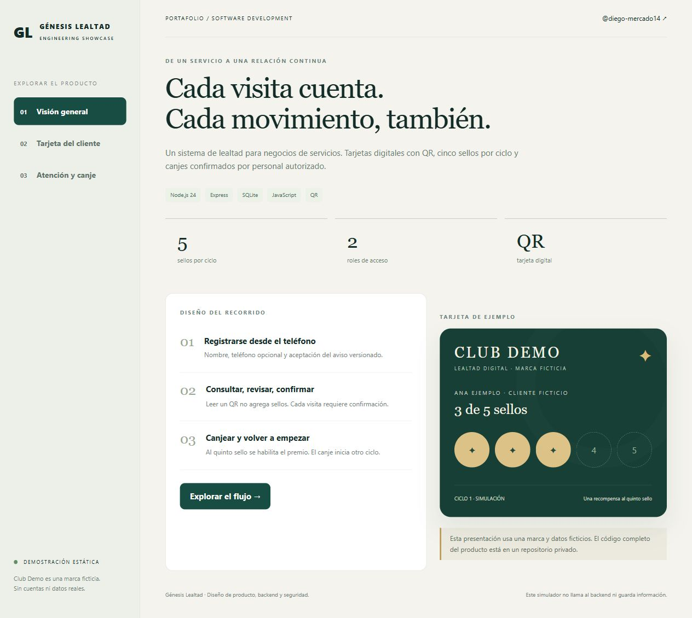
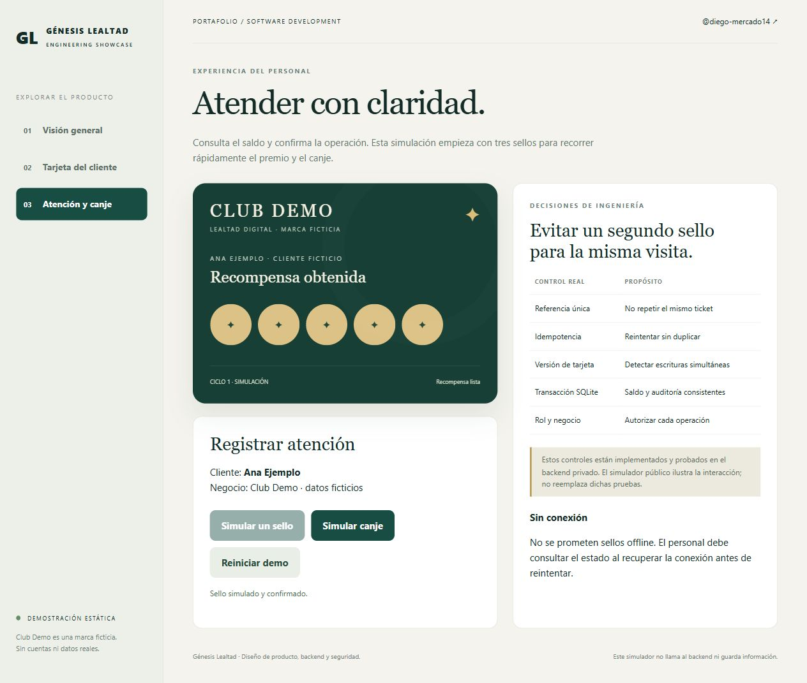

# Génesis Lealtad

**QR loyalty cards, consistent transactions, and a straightforward mobile experience.**

[Español](README.md) · [Architecture](ARCHITECTURE.md) · [Security and verification](SECURITY-AND-VERIFICATION.md)

A software portfolio project by [@diego-mercado14](https://github.com/diego-mercado14). This public repository explains the product and its engineering decisions. The complete product source is kept in a private repository.



**All screenshots show a purpose-built static simulation.** Club Demo and Ana Ejemplo are fictional. No client branding, photographs, active card credentials, personal records, databases or certificates are published. A GitHub repository is not a deployed backend.

## Problem and solution

Service businesses need a reliable way to recognize repeat visits without losing paper cards or counting the same service twice. Customers need to see their progress, staff need to confirm visits and rewards, and administrators need access control and an audit trail.

The implemented product issues an individual web card with a QR code after registration and versioned privacy consent. An authenticated staff member looks up the card, verifies a unique visit reference, and confirms a stamp. Five stamps create a reward. Authorized redemption resets the counter and starts another cycle while preserving the previous history.

## Implemented capabilities

- Customer registration, optional phone number, consent, QR card and balance lookup.
- Staff sign-in, QR decoding/search, explicit stamp and redemption confirmation.
- Administrator roles, staff access, reward settings, privacy notices, card suspension/rotation, anonymization, export and audit views.
- Persistent SQLite, migrations, encrypted backups, verified restore, preflight checks and local administrator recovery.



## Technology and architecture

Node.js 24, Express, SQLite through `node:sqlite`, JavaScript, HTML/CSS, qrcode, jsQR and passkit-generator. The production design is a single application instance behind an HTTPS reverse proxy with persistent local storage.

Every mutation checks the staff role and business scope. The balance change, visit reference and audit event are committed together. Unique references prevent duplicate tickets, card versions handle concurrent updates, and idempotency preserves the result when a request is retried. See the [architecture notes](ARCHITECTURE.md).

## Security and verification

Scrypt password hashing, secure session cookies, idle and absolute expiration, CSRF/Origin checks, tenant authorization, unpredictable QR tokens, AES-256-GCM encryption for retry responses and backups, and controlled anonymization are implemented.

**39 automated tests passed on Windows with Node 24 on November 9, 2026.** Coverage includes access control, concurrency, duplicate protection, consent, migrations, encryption, backup/restore and the mobile QA entrance. The publishable source was checked in a clean installation without private files. These results are not an external penetration test, a production availability claim or a physical iPhone camera test.

## Run the static demonstration

Download or clone the repository and open `demo/index.html`. No dependencies, credentials, API or account are needed. Alternatively:

```sh
python -m http.server 3200 --bind 127.0.0.1 --directory demo
```

Open `http://localhost:3200`. The Spanish interface lets you simulate two stamps, confirm the reward redemption, cancel an action and reset the demonstration. State exists only in memory. The QR contains `DEMO-NO-VALIDO` and grants no access. This simulator does not implement a live camera, registration, authentication or backend persistence.

## Run the complete product

Authorized collaborators use the private repository:

```sh
npm ci --ignore-scripts
npm test
npm run init-env
npm run setup
npm start
```

Secrets are generated locally. Apple credentials are optional and unnecessary for the web card. The project includes Windows 11 instructions, operator manuals and deployment configuration. Real hosting requires authorization, HTTPS, persistent storage, external backups and business configuration.

## Current status

The complete stamp/reward/redemption flow is implemented and tested locally. Production hosting has not been deployed. A protected, isolated HTTPS testing procedure is prepared, but physical iPhone 13/Android camera acceptance remains pending.

Apple Wallet has a `.pkpass` signing adapter. Genuine issuer certificates and an iPhone installation test are still required; automatic Wallet push updates are not implemented. MFA, email recovery and horizontal scaling are future improvements. No customer adoption, revenue, retention or uptime metrics are claimed.

This repository is a case study and a static simulator, not a distribution of the private product source. Professional contact: [GitHub profile](https://github.com/diego-mercado14).
