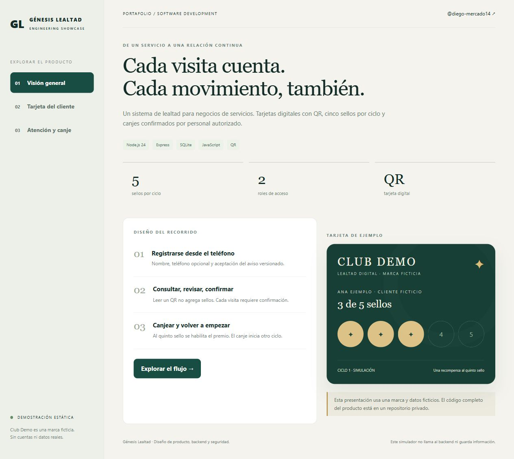
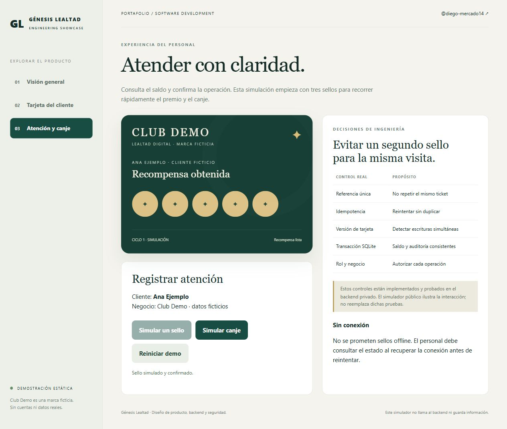
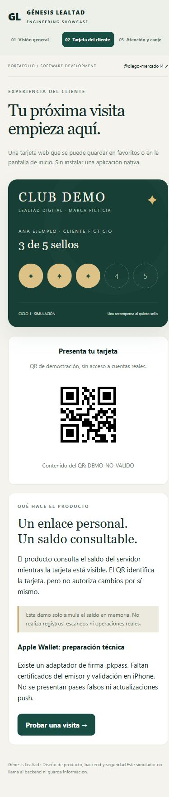
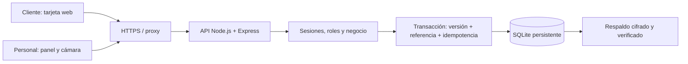

# Génesis Lealtad

**Fidelización con QR, transacciones consistentes y una experiencia móvil sencilla.**

[English](README.en.md) · [Arquitectura](ARCHITECTURE.md) · [Seguridad y verificación](SECURITY-AND-VERIFICATION.md) · [Demostración estática](demo/)

Proyecto de portafolio de [@diego-mercado14](https://github.com/diego-mercado14). Este repositorio presenta el diseño y las decisiones de ingeniería. El código completo del producto se conserva en un repositorio privado.



> Todas las capturas muestran una demostración estática creada para este portafolio. «Club Demo» y «Ana Ejemplo» son ficticios. No se incluyen marcas, fotografías, credenciales, QR activos ni información del negocio cliente. Publicar este repositorio **no despliega el backend**.

## El problema

Un negocio de servicios necesita reconocer visitas recurrentes sin depender de tarjetas de papel, perder el historial o registrar dos veces la misma atención. El cliente necesita consultar su progreso; el personal necesita confirmar visitas y premios; administración necesita trazabilidad y control de acceso.

## La solución implementada

Una aplicación web con tarjeta individual y QR. El cliente se registra aceptando un aviso versionado. Un barbero consulta la tarjeta, revisa una referencia de ticket y confirma el sello. Al completar cinco sellos se obtiene una recompensa; el canje autorizado reinicia el contador y conserva el historial del ciclo anterior.

| Experiencia | Funciones implementadas en el producto privado |
| --- | --- |
| Cliente | Registro web, consentimiento, tarjeta con QR, consulta de saldo y recompensa |
| Barbero | Acceso personal, búsqueda/lectura QR, confirmación de visitas y canjes |
| Administración | Equipo y roles, configuración, avisos, suspensión/renovación de tarjetas, anonimización, exportación y auditoría |
| Operación | SQLite persistente, migraciones, respaldos cifrados, restauración verificada, comprobación previa y recuperación local de acceso |

## Interfaces

| Atención y canje — simulación | Tarjeta móvil — simulación |
| --- | --- |
|  |  |

## Tecnologías y arquitectura

**Node.js 24 · Express · SQLite (`node:sqlite`) · JavaScript · HTML/CSS · qrcode · jsQR · passkit-generator**



El diseño usa una instancia de aplicación y disco persistente. Cada escritura valida rol y negocio. Las visitas, el saldo y la auditoría se guardan en la misma transacción. Una referencia única evita repetir el ticket; la versión de tarjeta detecta acciones simultáneas; la idempotencia permite reintentar sin duplicar el efecto. [Más decisiones y límites](ARCHITECTURE.md).

## Seguridad y pruebas

- Contraseñas scrypt; cookies de sesión protegidas; expiración absoluta y por inactividad.
- Comprobación de CSRF y Origin, autorización en servidor y aislamiento por negocio.
- QR aleatorio: identifica la tarjeta, pero no permite sumar sellos sin autorización.
- Respuestas de reintentos y respaldos cifrados con AES-256-GCM.
- Anonimización activa y auditoría; la retención de copias históricas requiere una política operativa.
- **39 pruebas automatizadas aprobadas** en Windows/Node 24 el 9 de noviembre de 2026. Cubren permisos, concurrencia, duplicados, registro, privacidad, migraciones, cifrado, recuperación y puerta de acceso móvil. No equivalen a un pentest externo ni a validación física de Safari.

No se incluyen bases, certificados, archivos de entorno ni credenciales. [Alcance de la revisión](SECURITY-AND-VERIFICATION.md).

## Ejecutar esta demostración

Clona o descarga este repositorio y abre `demo/index.html` en un navegador. No requiere instalación, cuenta, API ni secretos. Opcionalmente, con Python instalado:

```sh
python -m http.server 3200 --bind 127.0.0.1 --directory demo
```

Abre `http://localhost:3200`. En **Atención y canje**, confirma dos sellos simulados, observa el premio y confirma el canje. **Reiniciar demo** vuelve al estado ficticio inicial. Cancelar no cambia el saldo. Los cambios viven solamente en memoria y desaparecen al recargar.

El QR de la demo contiene `DEMO-NO-VALIDO`; no abre una cuenta real. No hay cámara, registro real, persistencia, autenticación o conexión a la aplicación privada en esta demo.

## Ejecutar el producto completo

El repositorio privado, para colaboradores autorizados, incluye instrucciones para Windows 11, dependencias fijadas, 39 pruebas y generación local de secretos:

```sh
npm ci --ignore-scripts
npm test
npm run init-env
npm run setup
npm start
```

No necesita secretos preexistentes ni certificados de Apple para operar la tarjeta web. No hay credenciales compartidas predeterminadas. Un despliegue requiere HTTPS, almacenamiento persistente, copias externas y configuración real del negocio.

## Estado real y siguientes pasos

| Área | Estado |
| --- | --- |
| Registro → cinco sellos → canje → cero | Implementado y comprobado por API y navegador local |
| Instalación sin archivos privados | Comprobada con copia limpia del código publicable |
| Showcase | Documentación y simulador estático con datos ficticios |
| Backend público de producción | No desplegado |
| Cámara de iPhone 13 y Android físicos | Protocolo y entorno HTTPS aislado preparados; aceptación física pendiente |
| Apple Wallet | Adaptador `.pkpass` preparado; faltan certificados reales y validación en iPhone |
| Actualizaciones push de Wallet | No implementadas |
| MFA, recuperación por email y escalado horizontal | Mejoras futuras, no funciones actuales |

La preparación técnica no demuestra uso por clientes, crecimiento comercial ni disponibilidad en producción; no se atribuyen métricas que no se han medido.

## Alcance de publicación

Este repositorio muestra el caso de estudio y su simulador. No otorga acceso al código privado ni una licencia sobre activos de terceros. Las capturas son propias de la demostración y no representan datos de un cliente real. Contacto profesional: [perfil de GitHub](https://github.com/diego-mercado14).
